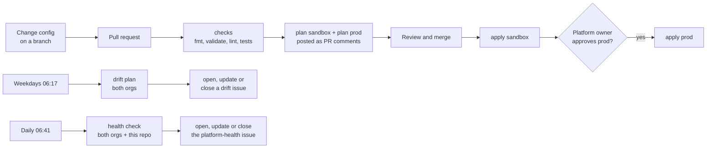

# platform-iac-template

[](../../actions/workflows/terraform-apply.yml)
[](../../actions/workflows/terraform-drift.yml)
[](../../actions/workflows/platform-health.yml)

GitHub organisation settings, teams, repositories and their protections, managed
as code with Terraform. Every repository is classified, and its **tier** decides
its branch rules. Every change is planned on a pull request, applied to a
**sandbox** org first, then to **prod** after approval. A **drift** check every
weekday says whether GitHub still matches the code; a **health** check every
morning covers what Terraform can't see.

It is a working lab and a reusable starting point: click **Use this template** to
start a new GitHub estate from it.

## How a change flows



## What it manages

| Area | Managed in code | Where |
|---|---|---|
| Organization | Member privileges, base permission `none`, web commit sign-off, projects | `organization.tf` |
| Actions | Allow-list, SHA pinning, read-only `GITHUB_TOKEN` | `actions.tf` |
| Teams | Teams, and each team's role on every repository | `teams.tf` |
| Classification | The custom property schema, and every repository's values | `custom_properties.tf` |
| Repositories | Settings, a ruleset built from the repository's tier, secret scanning, Dependabot, team access, creation from the template | `modules/repository/`, `locals.tf` |
| Templates | The repository templates (applications, and Terraform code-owned by the platform owners), and the org's default security policy, contributing guide and issue forms | `templates/`, published by `scripts/Publish-Templates.ps1` |
| Health | Two-factor authentication, member privileges, the Apps' permissions, this repository's own protections, failed runs | `.github/workflows/platform-health.yml` |

Deliberately manual: team membership, org owners, billing and Copilot seats, and
the few settings GitHub's API can't set, which the health check verifies every
morning instead. [docs/controls.md](docs/controls.md) explains each choice.

## Branch rules by tier

Each repository's `criticality` property is its tier. A repository may ask for
more than its tier, never for less.

| | tier-1 | tier-2 | tier-3 | experimental |
|---|:-:|:-:|:-:|:-:|
| Pull request, 2 approvals, code owner review | Yes | Yes | Yes | No ruleset |
| Stale approvals dismissed, conversations resolved | Yes | Yes | | |
| Linear history | Yes | | | |
| Required check `build-and-test` | Yes | Yes | | |
| Signed commits | Off, waits on a signing-key policy | | | |

All tiers allow squash merges only, block force-pushes and deletion, and let only
org owners bypass, through a pull request. The tiers live in `tier_policies` in
`platform.auto.tfvars`; the tests refuse a tier weaker than the one below it.

## Repository layout

| Path | What it is |
|---|---|
| `platform.auto.tfvars` | **The platform config**: teams, classification, tiers, repositories, policies. Identical in every environment. |
| `environments/*.tfvars` | Which org each environment manages, and its GitHub plan. |
| `*.tf` | The root module, one file per GitHub concept. |
| `modules/repository/` | One module builds every repository the same way. |
| `tests/` | Policy tests and guardrails, run against a mocked provider (no credentials needed). |
| `templates/` | The files published to `repository-template`, `terraform-module-template` and the org's `.github` repository. |
| `.github/workflows/` | `terraform-plan`, `terraform-apply`, `terraform-drift`, `platform-health`. |
| `.github/actions/terraform-setup/` | Shared job setup: environment to org, App token, Terraform, init. |
| `scripts/` | Bootstrap and template publishing (PowerShell), the health check and its tests, the CI allow-list check. |
| `docs/` | Setup guide, naming conventions, controls, templates, health check, and the [decision records](docs/adr). |

## Everyday tasks

- **Add a repository:** add an entry under `repositories` in
  `platform.auto.tfvars` with its description, its properties (`criticality`,
  `data-classification`, `contains-personal-data`, `technical-owner`) and
  `template = "repository-template"` (or `"terraform-module-template"` for
  Terraform, plus `team_access = { platform-owners = "maintain" }`). Open a pull
  request, read both plan comments, merge, then approve prod.
- **Change a repository's tier:** change its `criticality`. Its ruleset follows
  in the same pull request.
- **Change what a tier requires:** edit `tier_policies`. The plan shows every
  repository it affects.
- **Change one team's access to one repository:** set
  `team_access = { developers = "maintain" }` on that repository. `none` removes
  a default grant.
- **Publish the templates:** `.\scripts\Publish-Templates.ps1 -Environment sandbox`,
  then with `-Apply`, sandbox first. See [docs/templates.md](docs/templates.md).
- **Check for drift now:** Actions > terraform-drift > Run workflow. An issue
  labelled `drift` opens if GitHub differs from the code, and closes once it matches.
- **Check the platform's health now:** Actions > platform-health > Run workflow.
  See [docs/health.md](docs/health.md).
- **Undo drift:** Actions > terraform-apply > Run workflow. If the change was
  intended, put it in the code instead.

## Running Terraform locally (PowerShell, plans only)

```powershell
terraform login                                   # once: stores an HCP Terraform token
$env:TF_CLOUD_ORGANIZATION = "<your-hcp-org>"     # your HCP Terraform organization
$env:TF_WORKSPACE          = "github-platform-sandbox"
$env:TF_VAR_billing_email  = "you@yourdomain.com" # the org's billing email
$env:GITHUB_TOKEN          = gh auth token        # gh signed in as your personal account
terraform init
terraform plan -var-file=environments/sandbox.tfvars
terraform test -var-file=environments/sandbox.tfvars
```

Keep `TF_WORKSPACE` and `-var-file` on the same environment. Applies run only in
CI, so every change is reviewed, approved and recorded.

## Starting a new estate from this template

1. **Use this template** to create the new repository.
2. Edit `environments/*.tfvars` (org names and plan), `platform.auto.tfvars`
   (teams, classification, tiers and repositories), the org name in
   `.github/CODEOWNERS`, `control_repository.name` in `environments/prod.tfvars`,
   and the values in `templates/templates.json`.
3. Follow [docs/setup.md](docs/setup.md).

## Docs

- [Setup](docs/setup.md): one-time setup, step by step, and upgrading an existing lab.
- [Naming conventions](docs/naming-conventions.md): every name, the rule behind
  it, and how to rename something safely.
- [Controls](docs/controls.md): what each control does, why, and how to prove it works.
- [Templates](docs/templates.md): the repository template, the org defaults, and publishing them.
- [Health check](docs/health.md): what is checked every morning, and fixing what it finds.
- [Decision records](docs/adr): why it is built this way.
