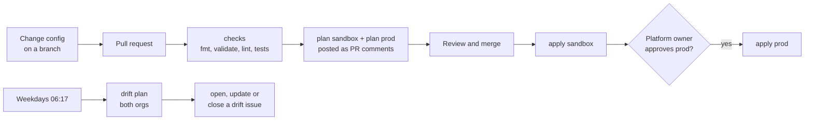

# platform-iac-template

GitHub organisation settings, teams, repositories and their protections, managed
as code with Terraform. Every change is planned on a pull request, applied to a
**sandbox** org first, then to **prod** after approval, and checked for **drift**
every weekday morning.

It is a working lab and a reusable starting point: click **Use this template** to
start a new GitHub estate from it.

## How a change flows



## What it manages

| Area | Managed in code | Where |
|---|---|---|
| Organization | Member privileges, base permission, projects | `organization.tf` |
| Actions | Allow-list, SHA pinning, read-only `GITHUB_TOKEN` | `actions.tf` |
| Teams | Teams, and each team's role on every repository | `teams.tf` |
| Repositories | Settings, branch ruleset, secret scanning, Dependabot, team access | `modules/repository/` |

Deliberately manual: team membership, org owners, the 2FA requirement (GitHub has
no API for it), billing and Copilot seats. [docs/controls.md](docs/controls.md)
explains each choice.

## Repository layout

| Path | What it is |
|---|---|
| `platform.auto.tfvars` | **The platform config**: teams, repositories, policies. Identical in every environment. |
| `environments/*.tfvars` | Which org each environment manages, and its GitHub plan. |
| `*.tf` | The root module, one file per GitHub concept. |
| `modules/repository/` | One module builds every repository the same way. |
| `tests/` | Policy tests and guardrails, run against a mocked provider (no credentials needed). |
| `.github/workflows/` | `terraform-plan`, `terraform-apply`, `terraform-drift`. |
| `.github/actions/terraform-setup/` | Shared job setup: environment to org, App token, Terraform, init. |
| `scripts/` | One-time bootstrap (PowerShell) and the CI allow-list check. |
| `docs/` | Setup guide, naming conventions, control-by-control explainer. |

## Everyday tasks

- **Add a repository:** add an entry under `repositories` in `platform.auto.tfvars`,
  open a pull request, read both plan comments, merge, then approve prod.
- **Change one team's access to one repository:** set
  `team_access = { developers = "maintain" }` on that repository. `none` removes
  a default grant.
- **Check for drift now:** Actions > terraform-drift > Run workflow. An issue
  labelled `drift` opens if GitHub differs from the code, and closes once it matches.
- **Undo drift:** Actions > terraform-apply > Run workflow. If the change was
  intended, put it in the code instead.

## Running Terraform locally (PowerShell, plans only)

```powershell
terraform login                                   # once: stores an HCP Terraform token
$env:TF_CLOUD_ORGANIZATION = "<your-hcp-org>"     # your HCP Terraform organization
$env:TF_WORKSPACE          = "github-platform-sandbox"
$env:TF_VAR_billing_email  = "you@yourdomain.com" # the org's billing email
$env:GITHUB_TOKEN          = gh auth token        # gh signed in as your personal account
terraform init
terraform plan -var-file=environments/sandbox.tfvars
terraform test -var-file=environments/sandbox.tfvars
```

Keep `TF_WORKSPACE` and `-var-file` on the same environment. Applies run only in
CI, so every change is reviewed, approved and recorded.

## Starting a new estate from this template

1. **Use this template** to create the new repository.
2. Edit `environments/*.tfvars` (org names and plan), `platform.auto.tfvars`
   (teams and repositories), the org name in `.github/CODEOWNERS`, and
   `control_repository.name` in `environments/prod.tfvars`.
3. Follow [docs/setup.md](docs/setup.md).

## Docs

- [Setup](docs/setup.md): one-time setup, step by step.
- [Naming conventions](docs/naming-conventions.md): every name, the rule behind
  it, and how to rename something safely.
- [Controls](docs/controls.md): what each control does, why, and how to prove it works.
